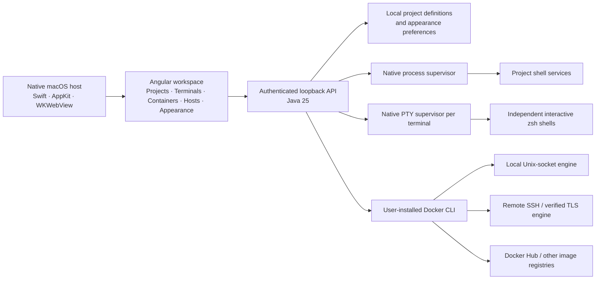

<div align="center">

# Runtime Bay

### A home for everything running.

**A macOS workspace for developers who want a clearer view of their services, containers, and machines.**

Start a project. Follow its output. Find the port. Restart the right process. Keep your flow.


<a href="#the-product">Product</a> ·
<a href="#architecture">Architecture</a> ·
<a href="#run-locally">Run locally</a> ·
<a href="#repository-map">Repository map</a> ·
<a href="#project-status">Status</a> ·
<a href="#license">License</a>

</div>

---

## The product

Development often means a scattered collection of terminal tabs, running servers, container dashboards, and remote connections. Runtime Bay brings the runtime work into one native Mac application, with projects as the starting point.

The question it helps answer is simple: **What is running, where is it running, and how do I control it?**

Your project files stay in their existing folders. Runtime Bay saves the commands you choose and runs them when you press Start. Its Java engine supervises those processes; its Angular interface keeps their state, output, and ports in view.

| Workspace | Available in v0.4 |
| --- | --- |
| **Projects & services** | Import folders; define commands and working directories; start, stop, and restart individual services or a project's services. |
| **Workspace terminals** | Open independent interactive zsh tabs below your projects with **＋ Terminal** or **⌘T**; resize, switch, and close shells without leaving the app. |
| **Runtime inspector** | Inspect bounded stdout/stderr output, filter and copy logs, see process IDs and observed TCP listeners. |
| **Containers** | Create stopped containers; start, stop, restart, pause, resume, and remove stopped containers; inspect logs and resource usage. |
| **Images & storage** | Pull Docker Hub or other registry images with progress/cancellation; inspect cached images, named volumes, and networks. |
| **Hosts** | A separate page for local Docker contexts and remote SSH or verified mutual-TLS environments. |
| **Appearance** | Twelve preset palettes with a live preview; Light, Dark, or System mode; preferences saved across app launches. |
| **Native macOS shell** | AppKit window and menus, WKWebView, native folder selection, appearance-aware window chrome, and the Runtime Bay app icon. |

The first-use appearance picker offers Harbor, Ocean, Glacier, Forest, Sage, Amber, Copper, Clay, Rose, Plum, Violet, and Graphite. Reopen it through **Customize appearance** or **⌘,**. Palettes recolor the workspace, sidebar, surfaces, controls, and log viewer; status colors continue to communicate state.

## The operating loop

```text
Import a project → add its service commands → start → inspect output and ports → stop or restart
Connect a host   → view its containers       → inspect, create, and control workloads
```

**Containers and Hosts have separate navigation entries.** Containers keeps a host selector so each action has an explicit destination. Hosts handles discovery and remote connection setup. Selecting **View containers** carries that host into the container workspace.

Shell services and workspace terminals stop when Runtime Bay closes. Docker containers keep running on their engine.

Workspace terminals start in the selected project’s root, or your home folder when there is no project. They keep running as you switch pages and reconnect after **⌘R**. Each tab has a close button that stops its shell and its processes. There is no application-imposed tab count; macOS resources set the practical limit. See [terminal behavior and lifecycle](docs/terminals.md).

## Architecture



The native host starts a Java backend on a random loopback port and supplies a per-launch session token. API requests require that token and validate their host and origin. The small C supervisor gives each service a dedicated process session and cleans up its descendants on Stop, shell exit, or loss of the Java owner.

Docker actions use explicit contexts and endpoint checks. Runtime Bay reuses Docker's credential helper, SSH configuration, keys, and host verification. It does not collect registry passwords or install a remote agent. Docker Hub stores images; Docker engines run containers.

Read the [architecture](docs/architecture.md), [container and remote-host guide](docs/containers.md), [appearance guide](docs/appearance.md), and [shared loading behavior](docs/loading.md) for details.

## Run locally

Development prerequisites:

- macOS 14 or newer.
- JDK 25 and Maven 3.6.3 or newer.
- Node.js 24.9 or newer in the Node 24 series, with npm.
- Apple's Command Line Tools (`xcode-select --install`).
- Optional Docker CLI and a running engine, such as Docker Desktop or Colima, for containers.

```sh
git clone https://github.com/L8TESTPR0JECTS/RuntimeBay.git
cd RuntimeBay
npm ci --cache .cache/npm
npm run dev
```

The development launcher builds the frontend, backend, and native host, then opens the application. Run `npm run watch:web` in a second terminal to rebuild Angular after edits; use **⌘R** in Runtime Bay to reload the workspace. Java and native changes require rebuilding and relaunching.

```sh
npm run check        # Process/API/persistence tests, palette checks, Angular build
npm run package:mac  # Build the native app, bundled Java runtime, and architecture-specific ZIP
open "dist/Runtime Bay.app"
```

The packaged application includes its Java runtime and does not require a separate JDK, Maven, or Node installation. Your service commands still require their own tools. Packaging targets the build machine's CPU architecture.

Local packages are ad hoc signed. Developer ID signing, notarization, and an automated public release pipeline remain future work.

### Try a workspace

Import this repository's `examples` directory and add:

| Name | Command | Working directory | TCP port |
| --- | --- | --- | --- |
| Demo API | `node server.mjs` | `.` | `4310` |
| Background worker | `/bin/zsh worker.sh` | `.` | Leave blank |

Start both services. Visit `http://127.0.0.1:4310/health` to generate output. Select a service to inspect its logs, then stop or restart it.

### Containers and remote machines

Open **Hosts** to discover Docker contexts or add an SSH address such as `ssh://developer@dev.example.com:22`. Verify SSH authentication and the host key through your normal Terminal workflow first. Existing verified mutual-TLS contexts are supported; unauthenticated TCP connections are rejected.

Open **Containers** to choose the target engine and manage its workloads. New containers require a cached image and are created stopped. TCP publishing binds to `127.0.0.1` on the selected host. For remote access, use an SSH port forward as described in the [container guide](docs/containers.md).

Private image pulls reuse Docker authentication. Sign in with `docker login <registry>` before pulling. Container removal requires a stopped container and confirmation; volumes are retained.

## Repository map

| Location | Responsibility |
| --- | --- |
| [`frontend/src/`](frontend/src/) | Angular workspace, container/host pages, palette tokens, appearance picker. |
| [`frontend/tests/`](frontend/tests/) | Palette contrast and preference validation checks. |
| [`backend/`](backend/) | Java API, local persistence, process orchestration, Docker adapter, integration tests. |
| [`native/`](native/) | Swift macOS host, C service/PTY supervisors, bundled license text. |
| [`scripts/`](scripts/) | Development, validation, native builds, and macOS packaging. |
| [`examples/`](examples/) | Small API and worker for trying the runtime workflow. |
| [`docs/`](docs/) | Architecture, current container behavior, appearance, and integration research. |
| [`notes/`](notes/) | Product ideas and early thinking, including portable development environments. |
| [`THIRD_PARTY_NOTICES.md`](THIRD_PARTY_NOTICES.md) | Dependency licenses and distribution notices. |

## Engineering character

Definitions and appearance settings live in `~/Library/Application Support/Runtime Bay/`, using atomic writes and user-only filesystem permissions. Runtime Bay needs no account or cloud service for core service management.

Commands execute through `/bin/zsh -lc` under your account, inside the selected project. The launch environment includes common Homebrew binary locations. Saved services do not automatically start when reopening the app.

Output stays in memory, bounded to 1,000 entries and 524,288 message characters per service. It resets when the app closes. Port inspection observes listeners with macOS `lsof`; it never terminates an external process. A listener is an observation rather than an application readiness check.

Validation covers real process ownership and shutdown, independent PTY shells, interactive input and Ctrl+C, window resizing, background-job cleanup, API authentication, persistence, Docker local/SSH/TLS discovery, endpoint changes, and container/image command construction. Remote tests use fixtures. Optional live-Docker tests use uniquely named disposable workloads; see the [test instructions](docs/containers.md#validation).

## Project status

**v0.4 is an early working foundation for macOS.** Runtime management, interactive terminal tabs, container management, separate host navigation, and customization are implemented.

The broader direction is to connect Git, coding agents, API collections, debugger sessions, and deployments to the same projects and runs. Those integrations are planned and are not included in the current application. See [integration research](docs/integrations.md).

Current boundaries include:

- Project service output is captured for inspection; use the separate workspace terminals for interactive commands. Terminal sessions and scrollback live in memory and end when the app closes.
- Independent services; dependency ordering, readiness checks, profiles, and run history are future work.
- Process ownership covers descendants in the supervised session; intentionally daemonized processes can escape that session.
- Docker standalone engines; Compose labels are displayed, but stack deployment, Kubernetes/Swarm, container exec, registry publishing, and volume/network deletion are future work.
- macOS only; no Windows build, auto-updater, telemetry, or published website.

## Contributing

Keep runtime orchestration in Java, interface behavior in Angular, and the native macOS host small. New integrations should reuse the project and runtime model. Run `npm run check` before proposing a change, and add meaningful coverage when changing process ownership, persistence, connection targeting, or the API security boundary.

Issues and pull requests are welcome in [RuntimeBay](https://github.com/L8TESTPR0JECTS/RuntimeBay).

## License

**Runtime Bay's original source is licensed under the [MIT License](LICENSE).** Copyright © 2026 Runtime Bay contributors.

Third-party software retains its own license:

| Component | License |
| --- | --- |
| Angular | MIT |
| GSAP | [Standard “No Charge” GSAP License](https://gsap.com/standard-license/) |
| RxJS | Apache-2.0 |
| tslib | 0BSD |
| Gson and Error Prone annotations | Apache-2.0 |
| Bundled OpenJDK runtime | GPL-2.0 with the Classpath Exception, plus its bundled notices |

See [THIRD_PARTY_NOTICES.md](THIRD_PARTY_NOTICES.md) for upstream references and distribution details. Packaging includes Runtime Bay's license, extracted frontend licenses, Apache license text, and the Java runtime's legal notices.

Portainer inspired the container/environment workflow; its code and agents are not bundled. Docker CLI is optional and installed by the user. Planned agent and API-testing tools are not shipped in this version.
