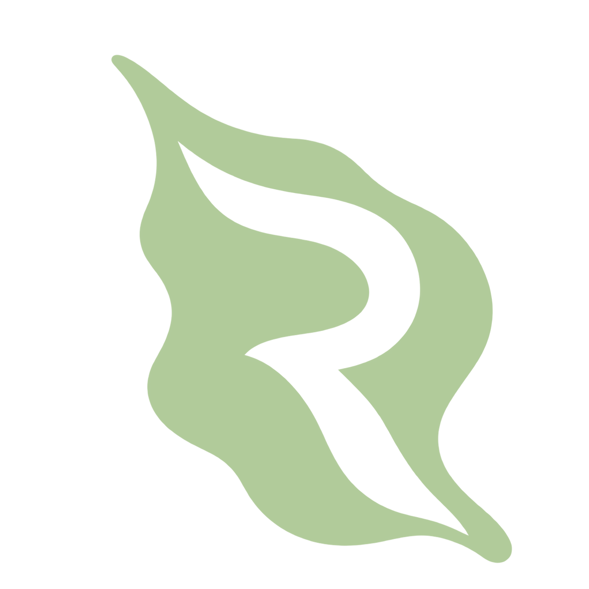
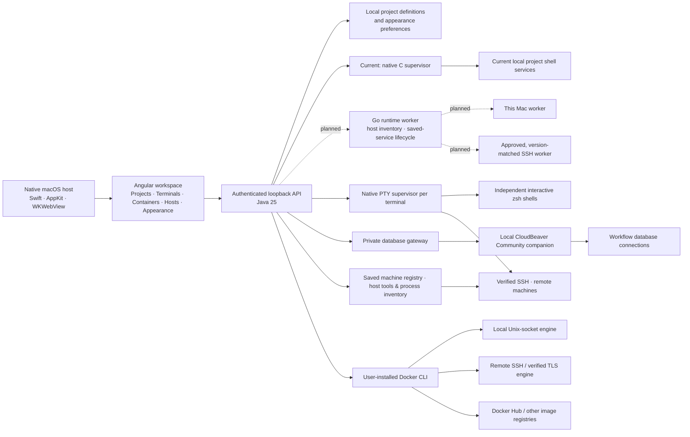

<div align="center">

# Runtime Bay



### A home for everything running.

**A macOS application for understanding and operating your development runtimes: services, containers, databases, terminals, and machines.**

Start a project. Follow its output. Find the port. Restart the right process. Keep your flow.


<a href="#the-product">Product</a> ·
<a href="#architecture">Architecture</a> ·
<a href="#run-locally">Run locally</a> ·
<a href="#repository-map">Repository map</a> ·
<a href="#project-status">Status</a> ·
<a href="#license">License</a>

</div>

---

## The product

Development often means a scattered collection of terminal tabs, running servers, container dashboards, and remote connections. Runtime Bay brings the runtime work into one native Mac application, with projects as the starting point.

The question it helps answer is simple: **What is running, where is it running, and how do I control it?**

Your project files stay in their existing folders. Runtime Bay saves the commands you choose and runs them when you press Start. Today its Java engine and native supervisor manage those processes; the roadmap adds a Go host worker for consistent inspection and service supervision across This Mac and remote machines. Java remains the workflow control plane, and Angular presents runtime state, output, and ports.

| Workspace | Available in v0.5 |
| --- | --- |
| **Projects & services** | Import folders; define commands and working directories; start, stop, and restart individual services or a project's services. |
| **Databases** | A CloudBeaver Community table browser and SQL editor inside each workflow, with saved connections, filtering, staged grid edits, and transaction controls. |
| **Workflow environments** | Create, rename, review, select, or remove environments. Bind each service to a machine and each container dependency to a saved container target; review effective changes before applying. In-use hosts and Docker connections are protected. Remote-bound services cannot fall back to local execution. |
| **Existing resource attachments** | Attach configured services, saved CloudBeaver connection references, and host terminal shortcuts per environment. Missing sources stay visible for explicit rebinding; unlinking preserves the source. Share pinned container references through the existing controls. |
| **Workflow containers** | Link existing local or remote containers to a project workflow; inspect live status/ports and start, stop, restart, or unlink dependencies. |
| **Workspace terminals** | Open independent interactive zsh tabs below your projects with **＋ Terminal** or **⌘T**; resize, switch, and close shells without leaving the app. |
| **Runtime inspector** | Inspect bounded stdout/stderr output, filter and copy logs, see process IDs and observed TCP listeners. |
| **Containers** | Create stopped containers; start, stop, restart, pause, resume, and remove stopped containers; inspect logs and resource usage. |
| **Images & storage** | Pull Docker Hub or other registry images with progress/cancellation; inspect cached images, named volumes, and networks. |
| **Hosts** | This Mac and saved SSH machines, independent of Docker; inspect Python, Java, Node.js, AWS CLI and other tools, view process snapshots, and open host-specific terminals. |
| **Appearance** | Twelve preset palettes with a live preview; Light, Dark, or System mode; preferences saved across app launches. |
| **Native macOS shell** | AppKit window and menus, WKWebView, native folder selection, appearance-aware window chrome, and the Runtime Bay app icon. |

The first-use appearance picker offers Harbor, Ocean, Glacier, Forest, Sage, Amber, Copper, Clay, Rose, Plum, Violet, and Graphite. Reopen it through **Customize appearance** or **⌘,**. Palettes recolor the workspace, sidebar, surfaces, controls, and log viewer; status colors continue to communicate state.

The same picker includes a **Font size** slider (12–20 px, default 14 px). It resizes workspace and terminal text while retaining layout dimensions, saves across launches, and works independently of page zoom.

Standard Mac shortcuts are available in the menu bar: **⌘+ / ⌘−** zoom, **⌘0** resets zoom, **⌘T** opens a terminal, **⇧⌘[ / ⇧⌘]** switches terminals, and **⌘O** imports a workflow. Zoom is remembered across launches. See the [keyboard shortcut guide](docs/shortcuts.md) for editing, window controls, and shortcut behavior.

## The operating loop

```text
Import a project → add its service commands → start → inspect output and ports → stop or restart
Add a host       → inspect tools & processes → open a terminal on that machine
Connect Docker   → view its containers       → inspect, create, and control workloads
```

**A workflow combines a project’s services and linked container dependencies.** Use **Link container** in the project view to select Kafka, a database, or another existing container from a Docker host. Links persist across launches; unlinking keeps the container intact. Containers created with a workflow project selected are linked automatically. Service controls and container controls remain explicit.

**Hosts represents machines.** Add Helfer or another physical/virtual node by hostname, IP address, or SSH configuration alias. **View host** inspects its login-shell tools and up to 100 process names/PIDs; **Open terminal** starts an interactive shell on that specific machine. Python 3, pip, Java, javac, Node.js, npm, AWS CLI, Git, Docker CLI, Maven, Gradle, pnpm, Yarn, and Go have individual availability/version results. Tool rows show their original brand logos, bundled for offline use. Hosts work without Docker. Optional SSH passwords are kept in memory for the app session and can be entered in Add/Edit Host; existing keys and SSH agents work too. See the [machine-host guide](docs/hosts.md).

**Containers owns Docker connections.** Its connection selector and **Docker connections** page manage local or remote Docker engines. A machine’s identity and preferred-host setting are separate from Docker context IDs and Docker’s active context.

Local shell services and app-owned terminal sessions stop when Runtime Bay closes. Closing an SSH tab disconnects its session; remote jobs may continue according to the remote shell and service manager. Docker containers keep running on their engine.

Local workspace terminals start in the selected project’s root, or your home folder when there is no project. New terminal tabs use Runtime Bay’s preferred machine; explicit **Terminal** buttons choose that machine directly. Remote SSH tabs start in the remote login environment and show the host name. Saved project service commands still execute locally; remote workflow service supervision is not implemented yet. They keep running as you switch pages and reconnect after **⌘R**. Each tab has a close button that stops its shell and its processes. There is no application-imposed tab count; macOS resources set the practical limit. See [terminal behavior and lifecycle](docs/terminals.md).

## Databases inside a workflow

Open a project, choose **Databases**, then **Open database workspace**. Runtime Bay starts a local, app-owned CloudBeaver Community companion on Docker and displays its GUI inside the app. The first use downloads the pinned Community image; later opens reuse it. Use CloudBeaver’s **New Connection** to add MySQL, PostgreSQL, or another supported database. For a database published on your Mac, use `host.docker.internal` and its published port from inside this companion.

The navigator, table grid, filters, sorting, SQL editor, and result grids belong to CloudBeaver. Grid changes are staged until **Save**; manual transaction mode also provides **Commit** and **Rollback**. SQL executes only when requested and follows that connection's transaction mode. Switching Runtime Bay views preserves the embedded editor. Connections and saved scripts survive app restarts; active transactions and unsaved edits should be resolved before closing the workspace or app.

See [database architecture, storage, and limitations](docs/databases.md). CloudBeaver is an optional Apache-2.0 dependency, downloaded from its official container registry; it is not copied into the app bundle.

## Architecture



The native host starts a Java backend on a random loopback port and supplies a per-launch session token. API requests require that token and validate their host and origin. Today the C supervisor gives each local service a dedicated process session and cleans up its descendants on Stop, shell exit, or loss of the Java owner. The roadmap moves saved-service ownership and host inventory to a versioned Go worker; Java will continue to authorize and coordinate workflow actions. See the [Java/Go runtime architecture](docs/architecture.md#planned-java-and-go-runtime-boundary) and stories RB-S08–RB-S10 in the [GitHub roadmap](https://github.com/orgs/L8TESTPR0JECTS/projects/4).

Docker actions use explicit contexts and endpoint checks. Runtime Bay reuses Docker's credential helper, SSH configuration, keys, and host verification. It does not collect registry passwords or install a remote agent. Docker Hub stores images; Docker engines run containers.

Read the [architecture](docs/architecture.md), [container and remote-host guide](docs/containers.md), [appearance guide](docs/appearance.md), and [shared loading behavior](docs/loading.md) for details.

## Run locally

Development prerequisites:

- macOS 14 or newer.
- JDK 25 and Maven 3.6.3 or newer.
- Go 1.26.1 or newer for the experimental worker tests in `npm run check`; the worker is not integrated into the app or deployed remotely.
- Node.js 24.9 or newer in the Node 24 series, with npm.
- Apple's Command Line Tools (`xcode-select --install`).
- Optional Docker CLI and a running engine, such as Docker Desktop or Colima, for containers.

```sh
git clone https://github.com/L8TESTPR0JECTS/RuntimeBay.git
cd RuntimeBay
npm ci --cache .cache/npm
npm run dev
```

The development launcher builds the frontend, backend, and native host, then opens the application. Run `npm run watch:web` in a second terminal to rebuild Angular after edits; use **⌘R** in Runtime Bay to reload the workspace. Java and native changes require rebuilding and relaunching.

```sh
npm run check        # Process/API/persistence tests, palette checks, Angular build
npm run package:mac  # Build the native app, bundled Java runtime, and architecture-specific ZIP
open "dist/Runtime Bay.app"
```

The packaged application includes its Java runtime and does not require a separate JDK, Maven, or Node installation. Your service commands still require their own tools. Packaging targets the build machine's CPU architecture.

Local packages are ad hoc signed. Developer ID signing, notarization, and an automated public release pipeline remain future work.

### Try a workspace

Import this repository's `examples` directory and add:

| Name | Command | Working directory | TCP port |
| --- | --- | --- | --- |
| Demo API | `node server.mjs` | `.` | `4310` |
| Background worker | `/bin/zsh worker.sh` | `.` | Leave blank |

Start both services. Visit `http://127.0.0.1:4310/health` to generate output. Select a service to inspect its logs, then stop or restart it.

### Containers and remote machines

Open **Hosts** to add a machine by hostname, IP address, or SSH alias, with optional user, port, and session password. For example, add `dev.example.com` with user `developer` and port `22`. Verify unknown host keys through your normal Terminal first. Host inspection and terminals are independent of Docker.

Open **Containers → Docker connections** to discover Docker contexts or add a Docker SSH endpoint such as `ssh://developer@dev.example.com:22`. Existing verified mutual-TLS contexts are supported; unauthenticated TCP connections are rejected.

Open **Containers** to choose the target engine and manage its workloads. New containers require a cached image and are created stopped. TCP publishing binds to `127.0.0.1` on the selected host. For remote access, use an SSH port forward as described in the [container guide](docs/containers.md).

Private image pulls reuse Docker authentication. Sign in with `docker login <registry>` before pulling. Container removal requires a stopped container and confirmation; volumes are retained.

## Repository map

| Location | Responsibility |
| --- | --- |
| [`frontend/src/`](frontend/src/) | Angular workspace, container/host pages, palette tokens, appearance picker. |
| [`frontend/tests/`](frontend/tests/) | Palette contrast and preference validation checks. |
| [`backend/`](backend/) | Java control plane API, local persistence, workflow orchestration, Docker adapter, integration tests. |
| [`runtime/`](runtime/) | Experimental versioned Go protocol/lifecycle worker and tests. App integration, inventory and production supervision remain RB-S09–RB-S10 work. |
| [`native/`](native/) | Swift macOS host, C service/PTY supervisors, bundled license text. |
| [`scripts/`](scripts/) | Development, validation, native builds, and macOS packaging. |
| [`examples/`](examples/) | Small API and worker for trying the runtime workflow. |
| [`docs/`](docs/) | Architecture, current container behavior, appearance, and integration research. |
| [`notes/`](notes/) | Product ideas and early thinking, including portable development environments. |
| [`licenses/`](licenses/) | Preserved upstream license texts and attribution; copied into macOS packages. |
| [`THIRD_PARTY_NOTICES.md`](THIRD_PARTY_NOTICES.md) | Dependency licenses and distribution notices. |

## Engineering character

Definitions and appearance settings live in `~/Library/Application Support/Runtime Bay/`, using atomic writes and user-only filesystem permissions. Runtime Bay needs no account or cloud service for core service management.

Commands execute through `/bin/zsh -lc` under your account, inside the selected project. The launch environment includes common Homebrew binary locations. Saved services do not automatically start when reopening the app.

Output stays in memory, bounded to 1,000 entries and 524,288 message characters per service. It resets when the app closes. Port inspection observes listeners with macOS `lsof`; it never terminates an external process. A listener is an observation rather than an application readiness check.

Validation covers real process ownership and shutdown, independent PTY shells, interactive input and Ctrl+C, window resizing, background-job cleanup, API authentication, persistence, Docker local/SSH/TLS discovery, endpoint changes, and container/image command construction. Remote tests use fixtures. Optional live-Docker tests use uniquely named disposable workloads; see the [test instructions](docs/containers.md#validation).

## Project status

**v0.5 is an early working foundation for macOS.** Runtime management, interactive terminal tabs, linked workflow containers, an embedded database GUI, container management, independent machine hosts with SSH terminals and tool/process inspection, and customization are implemented.

**The product direction is a persistent, application-aware workflow across multiple hosts.** The [workflow model](docs/workflow-model.md) now stores explicit environment/resource/target definitions and preserves legacy commands and container associations. A host is a resource target. Environment editing and complete operational layout restoration remain planned; current supported service execution is local, and container links can already target different Docker connections. An [experimental Go worker](docs/runtime-worker.md) and [ownership ADR](docs/decisions/0001-go-worker-ownership.md) establish the next runtime boundary; remote lifecycle guarantees and application integration remain open.

AI-enhanced tooling is planned to discover how an existing application is configured and help model a new application from the ground up. Git, coding agents, API collections, debugger sessions, and deployments also remain future integrations. These capabilities are not included in the current application. See [integration research](docs/integrations.md).

Current boundaries include:

- Project service output is captured for inspection; use the separate workspace terminals for interactive commands. Terminal sessions and scrollback live in memory and end when the app closes.
- Independent services; dependency ordering, readiness checks, profiles, and run history are future work.
- Current process ownership covers descendants in the supervised C session; intentionally daemonized processes can escape that session. The planned Go worker replaces saved-service supervision only after its ownership and reconnect behavior pass the RB-S08–RB-S10 checks.
- Docker standalone engines; Compose labels are displayed, but stack deployment, Kubernetes/Swarm, container exec, registry publishing, and volume/network deletion are future work.
- macOS only; no Windows build, auto-updater, telemetry, or published website.

The [GitHub roadmap](https://github.com/orgs/L8TESTPR0JECTS/projects/4) tracks the next work across seven epics and 22 stories. The [issue map](notes/github-issues.md) connects stable planning IDs to live issues, proposed priorities, milestones, and blockers; detailed outcomes and acceptance criteria live in the [backlog proposal](notes/backlog.md). Everything remains proposed until refined and moved from Backlog. A [CSV planning snapshot](notes/backlog.csv) is available for offline review or optional Jira import.

## Contributing

Keep workflow policy, persistence, and orchestration in the Java control plane; use the planned Go worker for host-local inspection and saved-service process lifecycle; keep the Angular interface focused on presentation and the Swift/C macOS host focused on OS integration and interactive PTYs. New integrations should reuse the workflow/runtime model. Run `npm run check` before proposing a change, and add meaningful coverage when changing process ownership, persistence, connection targeting, or the API security boundary.

Issues and pull requests are welcome in [RuntimeBay](https://github.com/L8TESTPR0JECTS/RuntimeBay).

## License

**Runtime Bay's original source is licensed under the [MIT License](LICENSE).** Copyright © 2026 Runtime Bay contributors.

Third-party software and artwork retain their own licenses; Runtime Bay's MIT license does not relicense them.

| Bundled component | Version | Purpose | License |
| --- | --- | --- | --- |
| Angular (`core`, `common`, `forms`, `platform-browser`) | 21.2.25 | Application interface | [MIT](licenses/Angular-MIT.txt) |
| xterm.js | 6.0.0 | Interactive terminal rendering | [MIT](licenses/xterm-MIT.txt) |
| xterm Fit addon | 0.11.0 | Terminal sizing | [MIT](licenses/xterm-fit-MIT.txt) |
| RxJS | 7.8.2 | Frontend reactive utilities | [Apache-2.0](licenses/RxJS-Apache-2.0.txt) |
| tslib | 2.8.1 | TypeScript runtime helpers | [0BSD](licenses/tslib-0BSD.txt) |
| GSAP | 3.15.0 | Breathing loader and UI animation | [Standard “No Charge” GSAP License](licenses/GSAP-Standard-License.txt), a custom license |
| Gson | 2.13.2 | Backend JSON handling | [Apache-2.0](licenses/Gson-Apache-2.0.txt) |
| Error Prone annotations | 2.41.0 | Gson's transitive annotation dependency | [Apache-2.0](licenses/ErrorProne-Apache-2.0.txt) |
| Devicon artwork | v2.17.0 | Original-color developer tool logos | [MIT](licenses/Devicon-MIT.txt); brand trademarks remain with their owners |
| OpenJDK Java runtime | Java 25; selected by the package build | Runs the backend without a separate Java installation | GPL-2.0 with the Classpath Exception and module-specific notices, retained under `Resources/jre/legal/` |

GSAP is free of charge under its own terms; it is not an MIT/Apache dependency. Its original notice and the upstream license snapshot are retained in [licenses/](licenses/).

| External integration | Distribution | License / ownership |
| --- | --- | --- |
| CloudBeaver Community 26.2.2 | Optional official container image, downloaded on demand and pinned by digest | [Apache-2.0](https://github.com/dbeaver/cloudbeaver/blob/devel/LICENSE); drivers and image dependencies retain their own notices |
| Docker CLI and engine | User-installed; not bundled | Docker CLI is [Apache-2.0](https://github.com/docker/cli/blob/master/LICENSE); the chosen engine or Docker Desktop distribution has its own terms |
| OpenSSH | macOS system client; not bundled | [Upstream OpenSSH notices](https://www.openssh.com/txt/LICENCE) and the system distribution's notices |

The native app uses macOS-provided AppKit, WebKit, Security, and system libraries. Swift/C code for Runtime Bay's native host, supervisors, and password helper is original project code. Portainer inspired the container workflow; its source and agents are not bundled. T3 Code, Codex, Claude, Bruno, and Postman are integration candidates, not shipped components.

See [THIRD_PARTY_NOTICES.md](THIRD_PARTY_NOTICES.md) for the inventory, build/test tooling, upstream sources, and package locations. The package includes Runtime Bay's license, the preserved license directory, extracted frontend notices, Devicon attribution, and the selected Java runtime's legal notices and build metadata.
