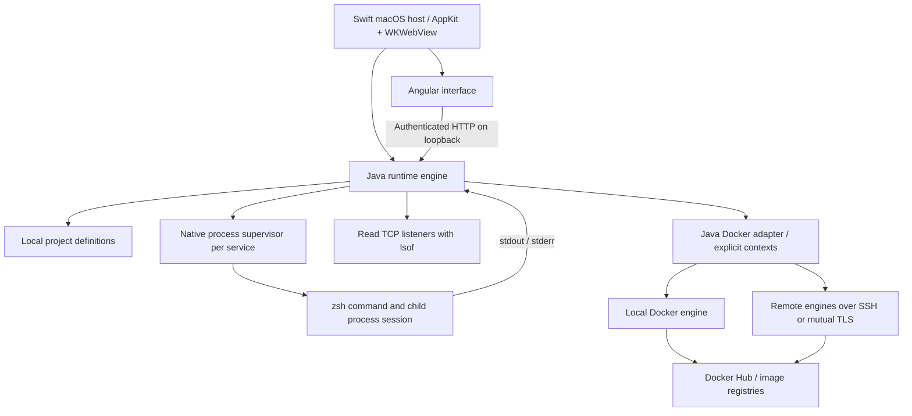

# Runtime Bay architecture

Status: v0.5, 2026-10-14. Service start/stop/restart, logs, ports, and container environments are implemented. Required stack: Java backend, Angular frontend, macOS first.

## Product purpose

Runtime Bay centralizes how a developer runs a project. A project is the shared context for services, logs, environments, Git changes, API requests, agent sessions, and deployment targets. Its useful distinction is the connection between those things.

An eventual workflow: open a project, start its API and worker, run an API collection against the chosen environment, inspect the failed request alongside the API output, ask an agent to fix the issue in a worktree, review its changes, and rerun the same checks. The runtime context stays visible throughout.

## Implemented topology

The Angular interface is web-rendered inside a native macOS application; its widgets are not SwiftUI/AppKit controls. The host owns native application lifecycle, menus, folder selection, the bundled Java engine, and session bootstrap. Java owns product logic. The C helper supplies the process-session and signal operations needed to supervise Unix services.

Capacitor's documented official platforms are Android, iOS, and web, making it a poor default for this macOS desktop project. Tauri remains a possible later host if Windows support becomes a priority. The initial implementation uses a small Swift host to align with the macOS-only focus and the available build tools. It adds no Rust or Node orchestration layer.

Java uses the JDK's HTTP server and virtual threads with Gson for JSON. A server framework is not required for this initial local engine. Maven produces one executable JAR; jlink packages a Java runtime into the app.

## Data model

- Project: stable ID, display name, real filesystem root, service definitions.
- Service definition: stable ID, name, shell command, relative working directory, optional TCP port.
- In-memory runtime: state, captured child session ID, supervisor process, exit code, start time, operation lock, bounded output.
- Output entry: sequence number, timestamp, stream, message. The UI requests entries after its last sequence.
- Port observation: configured port, observed listeners, their PIDs/commands, and membership of the managed process group.

Definitions and live process handles are separate. Reopening the app preserves definitions and begins with no managed services running. The app never reconstructs authority to terminate a process from a saved PID.

## Runtime lifecycle

Start validates the project directory again, launches a native supervisor, and waits for its child-session handshake. The supervisor creates a new Unix session before allowing the shell to execute. Java captures the session ID from the process it launched.

Java serializes changes to each service's runtime. Stop sends TERM through the supervisor, allows three seconds for graceful exit, then escalates to KILL for that captured process group. Restart completes Stop before creating a new session. Exit becomes stopped, exited, or failed after both output streams have drained.

The supervisor also watches its stdin pipe. If Java closes or crashes, pipe EOF triggers cleanup. If the shell exits while grandchildren remain, the supervisor cleans up that session before exiting. Commands that create another session to daemonize are outside this model; long-lived development commands should remain in the foreground.

## Workflow databases

Each workflow can start a local CloudBeaver Community companion through the [database subsystem](databases.md). A private, cookie-gated path in the existing Java HTTP server proxies its interface and API; CloudBeaver’s own login and cookies stay in the backend. The Angular shell keeps embedded frames mounted across view changes. The companion uses a loopback-only port, a persistent per-workflow directory, and an stdin watchdog for ownership cleanup. It receives neither the Docker socket nor project source mounts.

## Workflow containers

The app workspace contains project workflows. A workflow combines saved service commands with references to existing Docker containers. `WorkflowContainers` atomically stores these references in `workflow-containers.json`, independently of the existing project registry, so no migration of service definitions is needed.

Each reference pins project ID, Docker context, selected endpoint, and the complete container ID. Linking verifies current host identity and container existence, without modifying Docker labels or configuration. Newly created containers can also be associated with their selected workflow. Live status is grouped by host to avoid querying the same engine once per container. Missing containers and unavailable or changed hosts remain visible as references that can be unlinked offline. A recreated container must be explicitly linked again.

Workflow container actions require both project membership and the saved host/identity checks. Unlinking only removes metadata. Containers can be shared across workflows, and Docker workloads continue running after the app closes. The workflow's **Start services** and **Stop services** buttons control configured services; container operations use their own buttons. Linking does not imply startup ordering or readiness checks.

## Workspace terminals

A separate [terminal subsystem](terminals.md) owns interactive shells independently of configured services. A native `forkpty` supervisor starts each local login zsh or explicit SSH client in its own session. xterm.js renders UTF-8/ANSI output inside the Angular workspace. Input and resize requests, output cursor polling, and tab lifecycle use the same authenticated local API. Closing a tab or the engine cleans up the captured local process session. Disconnecting SSH does not imply ownership or termination of every remote process.

## Machine hosts

`HostRegistry` stores machine identities and Runtime Bay's preferred machine in `hosts.json`, independently of Docker's contexts. `MachineHosts` owns bounded asynchronous inspections; `HostTools` runs fixed version probes and a user-process snapshot through the selected machine's login shell. Remote probes use strict SSH host-key checks and batch authentication. Tooling, hostnames, and process names are rendered as text. No remote agent or Docker installation is required.

Host terminals and inspection may share an authenticated SSH connection through a private temporary control directory scoped to this app instance and machine ID/target/account. This supports signing in interactively before retrying inspection, without saving credentials. The native PTY executes the SSH argv directly; user-provided destinations are validated and never interpolated into a shell command. Session controls are cleaned after scan workers and terminal clients close.

The preferred machine applies to new terminal tabs. Saved project service definitions still execute locally; remote workflow supervision and deployment are future work. Docker engine configuration remains inside Containers, and machine actions do not mutate Docker settings.

## Local API boundary

The Java engine binds only to `127.0.0.1` on an OS-selected port. Swift generates a random token for each launch and injects it only into the trusted top-level application document. Every API operation requires the token. Host and Origin checks prevent ordinary browser pages from driving the engine; requests do not use cookie authentication.

The UI and API share an origin. Static assets carry a restrictive content policy. Navigation to external web pages opens the user's browser. The native folder-picker bridge accepts only messages from the trusted main frame. Runtime Bay configuration/token environment variables are removed before services inherit the environment.

These are local application boundaries, not isolation from other software running under the same macOS user. Services execute with that user's permissions. Importing a folder and saving a command do not execute it; Start is the execution action.

## Delivery sequence

1. **Runtime foundation (implemented):** project folders, service commands, start/stop/restart, child cleanup, bounded logs, listener inspection, native packaging.
2. **Runtime reliability:** declarative project manifest, dependency graph, readiness probes, environment profiles with Keychain secret references, persistent run history. Workspace PTY terminals and standalone Docker management are implemented; add Compose deployment and shared readiness/health behavior next.
3. **Git and agents:** Git status/diffs, worktrees, one Codex adapter, streaming agent events and approvals, and association of agent sessions with their worktree and runtime. Evaluate T3 reuse at a pinned upstream revision.
4. **API workflows:** Bruno collection execution, Postman-compatible imports subject to format support, shared environment values, request history, and results associated with the selected run.
5. **Debugging and deployment:** editor debugger launch/attach first, then protocol-based integrations and explicit deployment targets. Deployment history records the revision, configuration, and result.

Debugging has two levels: inspecting logs/processes/ports, and controlling breakpoints, stack frames, and variables. The second requires language-specific debugger adapters; it is not supplied by a process runner alone.

Deployment is a separate command boundary from local runtime controls. A future deployment action identifies its target and effective environment before executing. Opening the app must never deploy a saved project automatically.

## Open decisions

The purchased domain, minimum macOS/CPU support for public releases, final icon/branding, release signing identity, and first deployment provider still need owner input. The working app does not assume a domain. The source repository is [L8TESTPR0JECTS/RuntimeBay](https://github.com/L8TESTPR0JECTS/RuntimeBay). MIT is the initial source license; no upstream application source has been copied into this implementation.

## Container environments

The container component uses the existing authenticated loopback API. A Java adapter invokes Docker with argument arrays. Every engine operation selects an explicit context; ambient host/context/TLS overrides are removed. The context address is checked against the address selected in the UI before an operation. The app never switches the global Docker context.

Local Unix sockets, SSH endpoints, and contexts with verified mutual TLS are supported. Authentication and credential helpers remain with Docker/OpenSSH. New SSH environment setup creates context metadata only.

New containers can receive the `dev.runtimebay.project` label linking them to an imported project's ID. Existing Compose labels are shown too. The inspector returns selected state/network/mount/log/metric fields instead of full environment configuration. Creation environment values are passed through a temporary file with user-only permissions, then removed.

Image pulls are asynchronous, with bounded progress, errors, and cancellation. The UI can recover their status after page changes/reloads. Closing Runtime Bay cancels CLI work but does not stop Docker containers, whose lifecycle belongs to the selected engine.

## Appearance and host navigation

Containers and Hosts have distinct pages. The Docker workspace keeps the selected context when switching between them. Host discovery and remote setup belong to Hosts; workload inspection and mutations belong to Containers. Hosts does not continuously poll a remote engine.

Appearance uses shared semantic tokens, twelve preset palettes, and independent Light/Dark/System modes. An authenticated Java preference store saves the choice outside the ephemeral web origin. The native bridge applies the same appearance choice to macOS window chrome. See [appearance](appearance.md).
